<picture><source media="(prefers-color-scheme: dark)" srcset="assets/hero-dark.svg"></picture>

<picture><source media="(prefers-color-scheme: dark)" srcset="assets/social-l-dark.svg"></picture><a href="https://discord.com/users/1465212998065852447"><picture><source media="(prefers-color-scheme: dark)" srcset="assets/social-1-dark.svg"></picture></a><a href="https://www.hoyolab.com/accountCenter/postList?id=492112542"><picture><source media="(prefers-color-scheme: dark)" srcset="assets/social-2-dark.svg"></picture></a><a href="https://www.youtube.com/@theSUPREMERemiellegooner"><picture><source media="(prefers-color-scheme: dark)" srcset="assets/social-3-dark.svg"></picture></a><picture><source media="(prefers-color-scheme: dark)" srcset="assets/social-r-dark.svg"></picture>

<picture><source media="(prefers-color-scheme: dark)" srcset="assets/about-dark.svg"></picture>

<a href="https://github.com/echodotvbs/Remicord"><picture><source media="(prefers-color-scheme: dark)" srcset="assets/project-remicord-dark.svg"></picture></a>&nbsp;<a href="https://github.com/echodotvbs/echos-discord-textreplace-regex"><picture><source media="(prefers-color-scheme: dark)" srcset="assets/project-echos-discord-textreplace-regex-dark.svg"></picture></a>

<a href="https://github.com/echodotvbs/echos-css-snippets"><picture><source media="(prefers-color-scheme: dark)" srcset="assets/project-echos-css-snippets-dark.svg"></picture></a>

<picture><source media="(prefers-color-scheme: dark)" srcset="assets/stats-dark.svg"></picture>

<picture><source media="(prefers-color-scheme: dark)" srcset="assets/streak-dark.svg"></picture>

<picture><source media="(prefers-color-scheme: dark)" srcset="assets/wave-dark.svg"></picture>

<a href="https://metawka.github.io/expressive-profile/?from=echodotvbs"><picture><source media="(prefers-color-scheme: dark)" srcset="assets/credit-dark.svg"></picture></a>

